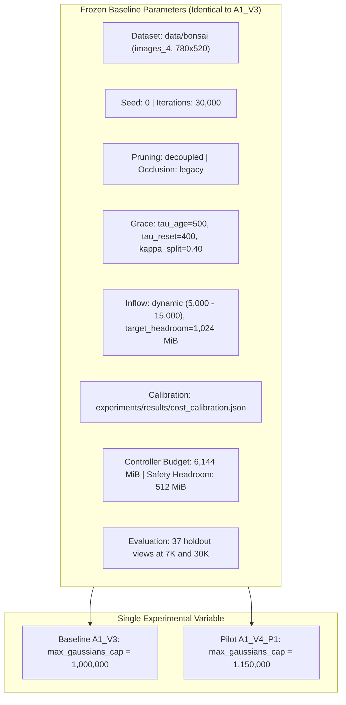
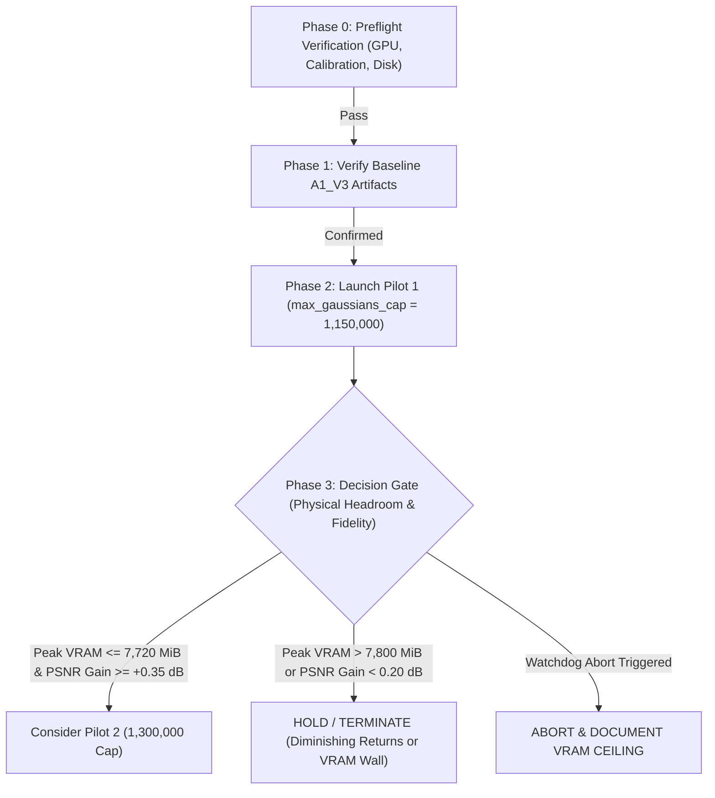

# PV-SRA-3DGS V4 Controlled Population-Cap Ablation Protocol

**Project:** Peak-VRAM-Constrained Spatial Resource Allocation for Memory-Bounded 3D Gaussian Splatting (PV-SRA-3DGS)  
**Experiment Series:** ZeroGS V4 Controlled Population-Cap Ablation  
**Hardware Environment:** NVIDIA GeForce RTX 5060 Laptop GPU (8,150.56 MiB Total Physical VRAM, Driver 573.24, CUDA 12.8)  
**Target Scene:** `data/bonsai` (`images_4`, canonical resolution $780 \times 520$, 292 total views, 37 holdout test views, seed 0)  
**Date:** 2026-11-05  
**Document Status:** Approved Experimental Specification (Ready for Controlled Execution; No Training Launched in this Turn)

---

## 1. Abstract & Executive Summary

This protocol defines the controlled ablation methodology for the PV-SRA-3DGS V4 population-cap investigation. In V3, Dynamic VRAM-Aware Inflow Admission expanded candidate admissions by +161%, driving reconstruction quality to 22.53 dB PSNR ($A_1^{(V3)}$). However, forensic analysis established that active scene growth plateaued at 1,000,000 Gaussians because it struck an arbitrary CLI ceiling (`--max_gaussians_cap 1000000`), rejecting over 83,000 valid candidates while the controller reported abundant headroom.

This study investigates whether expanding the population ceiling beyond 1.0M primitives produces meaningful visual and quantitative fidelity gains without causing physical CUDA Out-Of-Memory (OOM) on an 8 GB consumer GPU. 

Because physical GPU telemetry revealed that only 709.56 MiB of true physical device headroom remained in $A_1^{(V3)}$, this protocol **rejects a direct jump to 1.5M primitives as high-risk under observed hardware conditions**, and instead establishes a **rigorous staged pilot design** ($1.00\text{M} \to 1.15\text{M} \to 1.30\text{M}$ conditional).

---

## 2. Research Questions & Hypotheses

### Primary Research Question:
> **Does expanding the population ceiling beyond 1,000,000 Gaussians deliver sufficient reconstruction fidelity improvements to justify the additional physical VRAM risk and computational training runtime?**

### Hypotheses & Falsification Criteria:

| Hypothesis ID | Statement | Success / Confirmation Criterion | Falsification / Failure Criterion |
|---|---|---|---|
| **H1 (Capacity Constraint)** | The 1.0M ceiling artificially bottlenecked fine branch geometry in `bonsai`. | Expanding to 1.15M primitives yields $\Delta \text{PSNR} \ge +0.35\text{ dB}$ (reaching $\ge 22.88\text{ dB}$). | PSNR increases by $< 0.15\text{ dB}$ despite +150K Gaussians (indicating visual capacity saturation). |
| **H2 (Physical Safety Envelope)**| A +150K primitive expansion can execute within the observed 709 MiB physical device headroom. | Pilot 1 completes with Peak Device VRAM $\le 7,750\text{ MiB}$ (preserving $\ge 400\text{ MiB}$ physical headroom). | Peak Device VRAM exceeds $7,850\text{ MiB}$ or triggers emergency watchdog abort. |
| **H3 (Late-Stage Inflow Recovery)**| Expanding `max_gaussians_cap` restores dynamic inflow between iterations 13,800–14,900. | Admitted candidates in cycles 13,800–14,900 increase from ~6,000 to $> 10,000$ per cycle. | Admitted candidates remain low due to gradient exhaustion rather than population cap limits. |

---

## 3. Methodological Framework & Strict Single-Variable Isolation

### 3.1 Single-Variable Control Guarantee
To ensure unambiguous causal attribution, Pilot 1 ($A_1^{(V4-1.15M)}$) varies **strictly one parameter** relative to the $A_1^{(V3)}$ baseline: `max_gaussians_cap`. 

All other algorithmic heuristics, pruning thresholds, learning rates, seeds, and hardware configurations are frozen identical to the verified $A_1^{(V3)}$ baseline:



### 3.2 Controlled Parameter Matrix

| Experimental Parameter | Baseline ($A_1^{(V3)}$) | Pilot 1 ($A_1^{(V4-1.15M)}$) | Controlled Variable Status |
|---|:---:|:---:|:---:|
| **Experiment ID** | `A1_V3` | `A1_V4_P1` | Isolated Directory (`output/benchmark_bonsai_A1_V4_P1`) |
| **Population Ceiling (`--max_gaussians_cap`)** | **1,000,000** | **1,150,000** | **TREATMENT VARIABLE (+150K Primitives)** |
| **Pruning Lifecycle (`--pruning_mode`)** | `decoupled` | `decoupled` | Frozen (Stage 1 hygiene + Stage 2 admission) |
| **Opacity Prune Threshold (`--min_opacity_prune`)**| `0.005` | `0.005` | Frozen (Not altered in this ablation) |
| **Occlusion Physics (`--occlusion_physics_mode`)** | `legacy` | `legacy` | Frozen |
| **Inflow Admission Mode (`--inflow_mode`)** | `dynamic` | `dynamic` | Frozen |
| **Inflow Cap Bounds (`--inflow_cap_min/max`)** | 5,000 / 15,000 | 5,000 / 15,000 | Frozen |
| **Target Headroom (`--target_headroom_mb`)** | 1,024.0 MiB | 1,024.0 MiB | Frozen |
| **Age Grace Period (`--tau_age`)** | 500 iters | 500 iters | Frozen |
| **Reset Cooldown (`--tau_reset`)** | 400 iters | 400 iters | Frozen |
| **Split Quota Floor (`--kappa_split`)** | 0.40 | 0.40 | Frozen |
| **Cost Calibration Artifact** | Calibrated JSON | Calibrated JSON | Frozen (`SHA-256: 6114d1f9...`) |
| **Controller Hard Budget** | 6,144.0 MiB | 6,144.0 MiB | Frozen |
| **Controller Safety Headroom** | 512.0 MiB | 512.0 MiB | Frozen |
| **Non-PyTorch Allowance** | 256.0 MiB | 256.0 MiB | Frozen |
| **Input Image Source & Dimensions** | `images_4` ($780 \times 520$) | `images_4` ($780 \times 520$) | Frozen (Resolution -1, no dual-downsampling) |
| **Random Seed** | 0 | 0 | Frozen |
| **Training Steps & Checkpoints** | 30,000 (7K & 30K) | 30,000 (7K & 30K) | Frozen |
| **Holdout Evaluation Cameras** | 37 views | 37 views | Frozen |

---

## 4. Scientific Memory Modeling: 4-Tier Memory Decomposition

To prevent presenting hypothetical projections as empirical facts, all memory projections are categorized into 4 epistemological tiers:

```
[Tier 1: Measured Empirical Baseline] ──> nvidia-smi 7,441 MiB, Alloc 3,480 MiB, Headroom 709 MiB
[Tier 2: Calibrated Cost Calculation] ──> +150K Gaussians = +135.04 MiB Persistent (param+grad+Adam)
[Tier 3: Engineering Estimates]       ──> +100-150 MiB Allocator Virtual Fragmentation & Rasterizer
[Tier 4: Hypotheses to Test]          ──> Projected Peak: ~7,676-7,761 MiB (Exploratory Safety)
```

### 4.1 Detailed Tiered Decomposition Table

| Memory Component | Epistemological Status | Calculation / Source | Projected Delta (+150K) | Projected Delta (+500K) |
|---|---|---|:---:|:---:|
| **Baseline Physical VRAM** | **Tier 1: Measured Directly** | Peak `nvidia-smi` in $A_1^{(V3)}$ | **7,441.00 MiB** (Base) | **7,441.00 MiB** (Base) |
| **Observed Physical Margin** | **Tier 1: Measured Directly** | $8,150.56\text{ MiB} - 7,441.00\text{ MiB}$ | **709.56 MiB** (Base) | **709.56 MiB** (Base) |
| **Persistent Model Parameters** | **Tier 2: Calibrated Cost Model** | $\Delta N \times 59 \times 4\text{ bytes}$ | **+33.76 MiB** | **+112.53 MiB** |
| **Persistent Parameter Gradients**| **Tier 2: Calibrated Cost Model**| $\Delta N \times 59 \times 4\text{ bytes}$ | **+33.76 MiB** | **+112.53 MiB** |
| **Adam Optimizer States** | **Tier 2: Calibrated Cost Model** | $\Delta N \times 59 \times 8\text{ bytes}$ | **+67.52 MiB** | **+225.07 MiB** |
| **Total Persistent Model Load** | **Tier 2: Calibrated Cost Model** | $\Delta N \times 944\text{ bytes}$ | **+135.04 MiB** | **+450.13 MiB** |
| **PyTorch Allocator Fragmentation**| **Tier 3: Engineering Estimate** | Virtual uncoalesced block caching | **+50 to +100 MiB** | **+150 to +300 MiB** |
| **Rasterizer Screen-Space Buffers**| **Tier 3: Engineering Estimate** | Gaussian-tile intersection arrays | **+50 to +85 MiB** | **+150 to +250 MiB** |
| **Total Projected VRAM Burden** | **Tier 3: Engineering Estimate** | Sum of persistent + transient estimates | **+235 to +320 MiB** | **+750 to +1,000 MiB** |
| **Projected Peak Physical VRAM** | **Tier 4: Hypothesis to Test** | $7,441\text{ MiB} + \text{Burden}$ | **~7,676 to 7,761 MiB** | **~8,191 to 8,441 MiB** |
| **Projected Physical Headroom** | **Tier 4: Hypothesis to Test** | $8,150.56\text{ MiB} - \text{Projected Peak}$ | **+390 to +475 MiB** | **-40 to -290 MiB** |
| **Feasibility Assessment** | **Conclusion** | Hardware safety evaluation | **FEASIBLE FOR PILOT** | **HIGH-RISK (REJECTED)** |

---

## 5. Critical Audit of Safety Guards & Watchdog Mechanics

A forensic audit of hardware safety mechanisms identifies critical operational boundaries:

### 5.1 Operational Vulnerabilities & Corrections:
1. **Asynchronous Polling Gap (2.0s Interval):**
   - At ~21 iterations/sec, 2.0 seconds represents **42 complete training iterations**.
   - A densification cycle executes within a single step (~45 ms).
   - If an allocation spike pushes memory past 8,150 MiB during step 13,800, **the process will crash with CUDA OOM in $< 10\text{ ms}$**, completely undetected by a 2-second background monitor.
   - *Protocol Rule:* The 2.0-second `nvidia-smi` monitor is strictly for logging. Intra-cycle safety **must be enforced synchronously inside `train.py` before tensor allocation**.
2. **Synchronous Pre-Allocation Safety:**
   - Synchronous safety is enforced in `compute_dynamic_inflow_cap()` and `evaluate_admission()` by capturing `capture_cuda_memory()` immediately before knapsack allocation, ensuring $N_{\text{safe}}$ accounts for fixed overhead ($118.64\text{ MiB}$) and padding ($1.0\text{ MiB}$).
3. **The `empty_cache()` Semantic Boundary:**
   - `torch.cuda.empty_cache()` releases **only unoccupied cached virtual blocks** in PyTorch's allocator pool.
   - It **cannot release live allocated tensors** (parameters, optimizer states, active activations). If live allocated memory exceeds physical VRAM, calling `empty_cache()` frees 0 bytes.
4. **Checkpoint Memory Hazard (`torch.save` Overhead):**
   - The final checkpoint `chkpnt30000.pth` is **724 MiB**.
   - Standard `torch.save(model.state_dict())` serializes tensors. If tensors are cloned on GPU, serialization can allocate temporary GPU memory.
   - *Protocol Rule:* Under memory distress ($> 7,750\text{ MiB}$), emergency checkpointing **must detach tensors to Host CPU RAM (`.cpu()`) before serialization**, preventing GPU allocation during the save. If memory is insufficient even for CPU transfer, the process must rely on the previously saved periodic checkpoint (e.g. 7K) and execute a clean exit with code 2.

---

## 6. Phased Experimental Protocol



### Phase 0: Preflight Inspection
1. **GPU Background State:** Polled via `nvidia-smi`. Total VRAM used by external processes must be $\le 1,800\text{ MiB}$ (free VRAM $\ge 6,350\text{ MiB}$).
2. **Cost Calibration Hash:** SHA-256 of `experiments/results/cost_calibration.json` must match `6114d1f92644a460d74ecbb848883fcf50e332d70b95f9fe0e69572e7df844b4`.
3. **Disk Space:** Free disk space on drive `C:` must be $\ge 25.0\text{ GB}$.
4. **Unit Tests:** Execute `pytest tests/test_dynamic_inflow.py tests/test_vram_cache_reclamation.py` (must pass 100%).

### Phase 1: Baseline Verification
Confirm that baseline artifacts for $A_1^{(V3)}$ exist and are verified:
- Checkpoint: `output/benchmark_bonsai_A1_V3/chkpnt30000.pth` (30K PSNR: **22.53 dB**, SSIM: **0.7378**, LPIPS: **0.4086**).
- Peak Device VRAM: **7,441.00 MiB** (Headroom: **709.56 MiB**).
- Final PLY Primitives: **1,000,000**.

### Phase 2: Execution of Pilot 1 ($A_1^{(V4-1.15M)}$)
- Target Output: `output/benchmark_bonsai_A1_V4_P1`
- Monitoring: Continuous polling of physical VRAM and per-cycle telemetry logging.

### Phase 3: Decision Gate Criteria

Following the completion of Pilot 1, the decision to proceed to Pilot 2 (1.30M) will be governed by strict quantitative criteria:

| Decision Outcome | Trigger Conditions | Next Action |
|---|---|---|
| **GATE OPTION A: PROCEED TO PILOT 2** | 1. Pilot 1 completed with exit code 0.<br>2. Measured Peak Device VRAM $\le 7,720\text{ MiB}$ (leaving $\ge 430\text{ MiB}$ physical headroom).<br>3. Fidelity gain $\Delta \text{PSNR} \ge +0.35\text{ dB}$ over $A_1^{(V3)}$ (reaching $\ge 22.88\text{ dB}$). | Authorize preparation of Pilot 2 ($N_{\text{cap}} = 1,300,000$). |
| **GATE OPTION B: HOLD AT PILOT 1** | 1. Pilot 1 completed with exit code 0.<br>2. Peak Device VRAM was between $7,720\text{ MiB}$ and $7,850\text{ MiB}$ (headroom $< 300\text{ MiB}$), OR<br>3. Fidelity gain was marginal ($\Delta \text{PSNR} < 0.20\text{ dB}$, diminishing returns). | Conclude population-cap investigation; declare 1.15M as the optimal Pareto ceiling on 8 GB hardware. |
| **GATE OPTION C: ABORT / FAILED PILOT** | 1. Watchdog abort was triggered, OR<br>2. CUDA OOM occurred during training or evaluation. | Reject population expansion beyond 1.0M on 8 GB GPUs; document physical memory wall. |

---

## 7. Limitations & Reproducibility Statement

1. **Single-Seed Limitation:**
   Pilot 1 uses `seed = 0` matching the canonical baseline. A single seed is sufficient for **exploratory feasibility screening and hardware boundary detection**, but cannot establish formal statistical significance. If Pilot 1 demonstrates positive gains and safety, multi-seed replication (seeds 0, 42, 123) will be scheduled.
2. **Scene Specificity:**
   This protocol evaluates `data/bonsai`. Memory scaling and Gaussian count dynamics depend on scene extent, visual complexity, and camera trajectory. Results on `bonsai` do not guarantee identical headroom margins on unbounded outdoor scenes (e.g. `bicycle` or `garden`).
3. **No Execution Guarantee:**
   This document is a protocol specification. **No training is launched during this turn.** Execution requires explicit authorization from the primary investigator.
